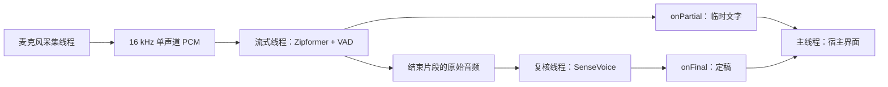
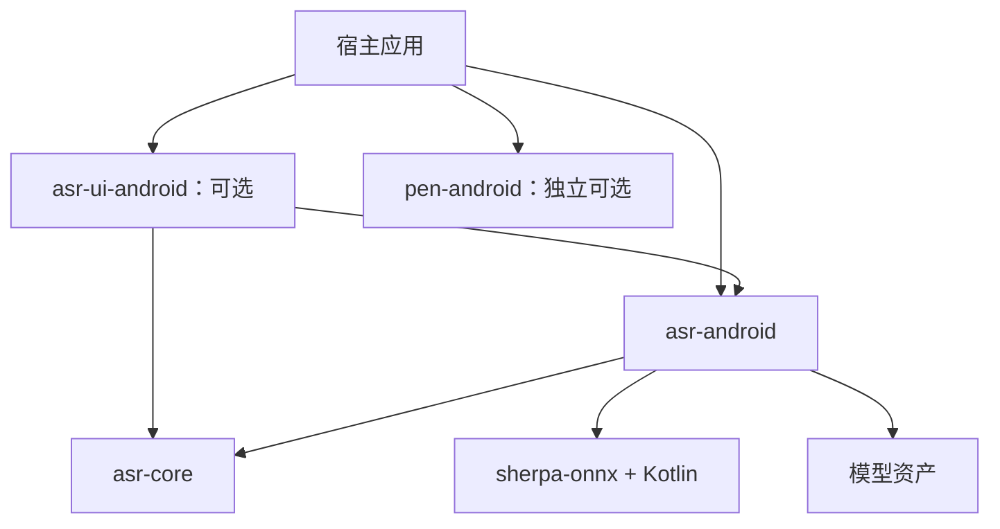

# ASR 架构与合约

## 实际使用的组件

| 组件 | 职责 |
|---|---|
| Zipformer small bilingual 2023-02-16 | 中英双语流式初稿 |
| Silero VAD | 判断语音片段和停顿 |
| SenseVoiceSmall INT8 2024-07-17 | 对片段原音频进行第二遍识别，生成定稿 |
| sherpa-onnx 1.13.8 | Android 原生推理运行库；底层使用 ONNX Runtime |
| FunASR | 两遍思路参考；不参与当前运行，没有部署其服务 |

VAD 与流式初稿在同一线程按相同音频顺序推进，片段结束后重建在线 stream。SenseVoice 使用 VAD 返回的原音频，不使用初稿作为提示，也不融合两套模型的置信度。当前规则是以第二遍结果作为定稿，初稿错误也可能在第二遍保留或变成其他错误。

## 模块依赖

`asr-core` 没有 Android 或模型依赖，定义 Java API 和状态规则。它不是已实现的跨平台 C++ 推理内核；Swift、C++、ArkTS 需要遵循相同语义重新接入原生运行库。

## 公开 API

`AsrEngine`：

| 方法 | 含义 |
|---|---|
| `start(listener)` | 取消上一会话，再准备模型并开始录音；宿主先获得麦克风授权 |
| `stop()` | 停止采集，处理排队中的音频，flush 末句，等待全部定稿后 `onDone` |
| `cancel()` | 停止采集并抑制未送达回调；不等待正在执行的原生推理立即中断 |
| `close()` | 幂等关闭；按队列顺序释放 stream/VAD/模型并关闭线程池；随后不可 start |

Android 实现为 `AndroidAsrEngine`。这些生命周期方法必须从主线程调用。当前类不会主动监听 Activity 生命周期；宿主负责在后台调用 cancel，在销毁时 close。

`AsrListener`：

| 回调 | 语义 |
|---|---|
| `onReady()` | 两套模型已准备，麦克风已启动 |
| `onPartial(phraseId, text)` | 一句的暂态结果，可能变化、变短或为空 |
| `onFinal(phraseId, text)` | 一句的最终结果；空结果也会结束对应 pending 句 |
| `onLevel(rms)` | 归一化采样的 RMS，可做音量指示 |
| `onDone()` | 正常停止或时限结束，所有最终结果已处理 |
| `onError(message)` | 当前会话失败；之前的定稿应保留 |

所有回调在 Android 主线程。每次 start 的 phraseId 从 0 开始，不能单独当作跨会话唯一 ID。宿主如果另加异步工作，需要把会话 generation 一同保留。模块内部通过取消标志阻止旧任务回调；`SpeechSession` 提供额外的宿主会话校验。

## 界面更新规则

`SpeechDrafts` 按句子 ID 管理临时文字。收到某句 final 时仅移除该句及更早的 pending 项，后一句保持显示。定稿追加到可编辑区，不重新设置全部文本，不覆盖用户修改。新会话清空 pending 状态，保留已有定稿。错误和取消不删除已有定稿。

临时区和定稿区是两份有明确生命周期的数据，不要把每次 partial 当作新的句子追加，也不要用 final 清空全部临时区。

## 音频、线程与边界

- 采样目标：16000 Hz、单声道、PCM16，转换为 `[-1,1)` float；512 samples/块约 32 ms。
- Android 录音源为 `VOICE_RECOGNITION`，优先内置麦克风；缓冲至少约 1 秒。
- 采集、流式/VAD、最终推理三个串行执行器；UI 只接收回调。
- 默认 2 个流式推理线程、4 个 SenseVoice 推理线程、1 个 VAD 线程。更多线程不代表更快，应测目标设备。
- 停顿阈值默认 0.65 秒；VAD 目标最长片段 12 秒，实际片段可能略长。
- 正常停止先排完流式音频，再结束 VAD，最后等待复核队列；避免漏掉末句。
- 默认会话上限 60 秒，可配置 1–300 秒。队列总输入量受会话时限约束，当前不是无限长度的实时队列；极慢设备仍可能积压。长会议版本需要额外的队列水位控制和分段落盘策略，不能直接取消时限。
- stop/cancel 会立即尝试停止 AudioRecord；已有 native decode 可能仍运行一小段时间。cancel 只阻止其结果再进入界面。
- 仅存内存音频和界面文本，无文件保存或云端回退。示例销毁进程后不保证文本保留。

参考：[sherpa-onnx](https://github.com/k2-fsa/sherpa-onnx)、[FunASR 两遍识别说明](https://github.com/modelscope/FunASR/blob/main/runtime/docs/SDK_tutorial_online.md)。
